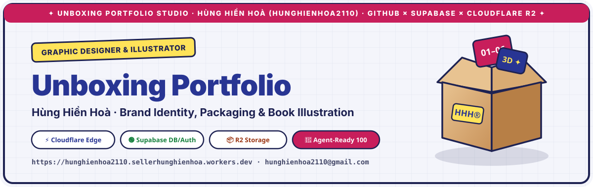
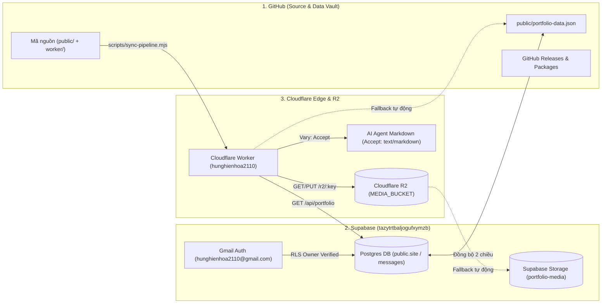

<div align="center">



<br />

# 🎁 Unboxing Portfolio — Hùng Hiền Hoà (`hunghienhoa2110`)

**Interactive 3D Unboxing Graphic Design & Illustration Portfolio**  
*Brand Identity · Packaging Design · Book Illustration · Editorial Layout · Advertising Campaigns · Event Visual Identity*

[](https://hunghienhoa2110.sellerhunghienhoa.workers.dev)
[](https://github.com/sellerhunghienhoa/hunghienhoa2110/releases)
[](https://github.com/sellerhunghienhoa/hunghienhoa2110/actions)
[](https://hunghienhoa2110.sellerhunghienhoa.workers.dev/llms.txt)
[](./LICENSE)

[**✨ Trải nghiệm Web trực tiếp**](https://hunghienhoa2110.sellerhunghienhoa.workers.dev) · [**📦 Xem Releases**](https://github.com/sellerhunghienhoa/hunghienhoa2110/releases) · [**🐳 Xem Packages**](https://github.com/sellerhunghienhoa/hunghienhoa2110/pkgs/npm/hunghienhoa2110) · [**🤖 Tài liệu AI Agent (`/llms.txt`)**](https://hunghienhoa2110.sellerhunghienhoa.workers.dev/llms.txt) · [**🛡️ Chính sách Bảo mật**](https://hunghienhoa2110.sellerhunghienhoa.workers.dev/privacy.html)

</div>

---

## 🌟 Giới thiệu (Overview)

> *“Mình là **Hùng Hiền Hoà (`hunghienhoa2110`)**, graphic designer và illustrator thích kể chuyện bằng màu sắc, chữ và những nhân vật nhỏ. Mỗi dự án với mình đều giống như một chiếc hộp quà — khi mở ra là cả một câu chuyện sáng tạo bên trong.”*

Kho lưu trữ này vận hành toàn bộ hệ sinh thái **Unboxing Portfolio** theo kiến trúc 3 tầng tự động hoá hoàn toàn dưới tài khoản chính chủ **`hunghienhoa2110@gmail.com`**:

1. **GitHub (`sellerhunghienhoa/hunghienhoa2110`):** Lưu trữ mã nguồn chuẩn, lịch sử phiên bản (**Releases**), gói phân phối (**GitHub Packages** NPM & Container `ghcr.io`), và bản sao lưu dữ liệu chuẩn [`public/portfolio-data.json`](./public/portfolio-data.json).
2. **Supabase (`tazytrtbaljogufxymzb`):** Xác thực tài khoản Gmail 1 bước (`Supabase Auth`), cơ sở dữ liệu thời gian thực (`public.site`, `public.messages`, `public.public_profiles`) bảo vệ bằng **Row Level Security (RLS)**, và kho lưu trữ tệp `portfolio-media`.
3. **Cloudflare Edge Worker & R2 (`hunghienhoa2110`):** Phân phối giao diện tĩnh siêu tốc tại biên, xử lý đàm phán nội dung **Markdown Content Negotiation (`Accept: text/markdown`)** cho AI Agent, và lưu trữ đối tượng đa phương tiện qua **Cloudflare R2 (`/r2/:key`)**.

---

## 🏗️ Kiến trúc Luồng Dữ liệu Tự động (System Architecture)



---

## 🎨 06 Chương Dự án Tiêu biểu (Featured Portfolio Chapters)

| Chương | Lĩnh vực | Tên Dự án | Công cụ sử dụng | Hạng mục bàn giao (Deliverables) |
| :--- | :--- | :--- | :--- | :--- |
| **01** | `BRANDING` | **Aoki Coffee Brand** *(Quán cà phê)* | Adobe Illustrator, Photoshop | Moodboard · Logo System · Pattern · Stationery Mockup |
| **02** | `MEDIA CAMPAIGN` | **Chiến dịch truyền thông** *(Advertising)* | Adobe Illustrator, Photoshop | Key Visual Process · Sketch · Final · Social Post |
| **03** | `EVENT` | **Nhận diện sự kiện** *(Live Music Concert)* | Adobe Illustrator, After Effects | Moodboard · Key Visual Sketch · Final · Concert Poster |
| **04** | `LAYOUT` | **Catalogue thiết kế lại** *(Redesign)* | Adobe InDesign, Illustrator | Moodboard · Cover · Spread · Catalogue Layout |
| **05** | `PACKAGING` | **Bao bì trà** *(Specialty Tea)* | Adobe Illustrator, Photoshop | Visual Research · Primary & Secondary Packaging · Set |
| **06** | `ILLUSTRATION` | **Lịch và minh hoạ sách** *(Calendar & Book)* | Procreate, Adobe Illustrator | Moodboard · Sketch · Final · Calendar & Book Spreads |

---

## 📦 GitHub Packages & Releases

Dự án được đóng gói tự động trên cả **GitHub NPM Registry**, **GitHub Container Registry (`ghcr.io`)**, và **GitHub Releases**:

### 1. Cài đặt qua GitHub Packages (NPM)
```bash
npm install @sellerhunghienhoa/hunghienhoa2110 --registry=https://npm.pkg.github.com
```

### 2. Chạy qua GitHub Container Registry (Docker / OCI)
```bash
docker pull ghcr.io/sellerhunghienhoa/hunghienhoa2110:latest
docker run -p 8787:8787 ghcr.io/sellerhunghienhoa/hunghienhoa2110:latest
```

### 3. Đồng bộ toàn trình (GitHub $\leftrightarrow$ Supabase $\leftrightarrow$ Cloudflare)
```bash
# Chạy 7/7 bài kiểm thử tự động
npm test

# Đồng bộ dữ liệu từ Supabase -> lưu vào GitHub -> triển khai lên Cloudflare Worker & R2
npm run sync
```

---

## 🤖 Chuẩn Sẵn sàng cho AI Agent (Agent-Ready Specification)

Hệ thống đạt chuẩn **Ora Agentic Readiness** với đầy đủ Content Negotiation (`Vary: Accept`), JSON-LD (`Person`, `ProfessionalService`, `WebSite`) và hướng dẫn dành riêng cho AI Agent:

| Endpoint | Phương thức | Header / Định dạng | Mô tả |
| :--- | :--- | :--- | :--- |
| `/` | `GET` | `Accept: text/html` | Giao diện 3D Unboxing tương tác cho trình duyệt |
| `/` | `GET` | `Accept: text/markdown` | Toàn văn hồ sơ năng lực định dạng Markdown chuẩn cho AI Agent |
| `/api/portfolio` | `GET` | `application/json` | Dữ liệu JSON thời gian thực từ Supabase (kèm fallback `portfolio-data.json`) |
| `/r2/:key` | `GET`, `PUT` | `image/webp` | Đọc/ghi tài nguyên ảnh trên Cloudflare R2 & Supabase Storage `portfolio-media` |
| `/llms.txt` | `GET` | `text/markdown` | Chỉ mục hướng dẫn & *When-to-Use* cho AI Agent |
| `/llms-full.txt` | `GET` | `text/markdown` | Hồ sơ chi tiết toàn bộ 6 dự án & thông số kỹ thuật |
| `/health` | `GET` | `application/json` | Trạng thái kết nối GitHub · Supabase · Cloudflare R2 |

```bash
# Kiểm tra phản hồi Markdown dành cho AI Agent:
curl -sS -L -i -H "Accept: text/markdown" https://hunghienhoa2110.sellerhunghienhoa.workers.dev/
```

---

## 🛡️ Tuân thủ Pháp lý & An toàn Thông tin (Legal & Security Compliance)

- **Bảo vệ dữ liệu cá nhân:** Tuân thủ **Nghị định 13/2023/NĐ-CP** (hỗ trợ người dùng tự trích xuất dữ liệu cá nhân ra JSON và tự xóa dữ liệu trực tiếp trong mục *Tài khoản*). Xem chi tiết tại [`/privacy.html`](https://hunghienhoa2110.sellerhunghienhoa.workers.dev/privacy.html).
- **An toàn thông tin mạng:** Bảo vệ bởi **Supabase RLS** (`private.is_owner()` khóa cứng `hunghienhoa2110@gmail.com`), **HSTS**, **CSP**, và công bố lỗ hổng theo chuẩn **RFC 9116** tại [`/.well-known/security.txt`](https://hunghienhoa2110.sellerhunghienhoa.workers.dev/.well-known/security.txt) & [`SECURITY.md`](./SECURITY.md).

---

<div align="center">
  <strong>© 2026 Hùng Hiền Hoà (<code>hunghienhoa2110@gmail.com</code>)</strong><br />
  <sub>Crafted with 3D CSS · Supabase · Cloudflare Workers & R2 · Impeccable UI</sub>
</div>
